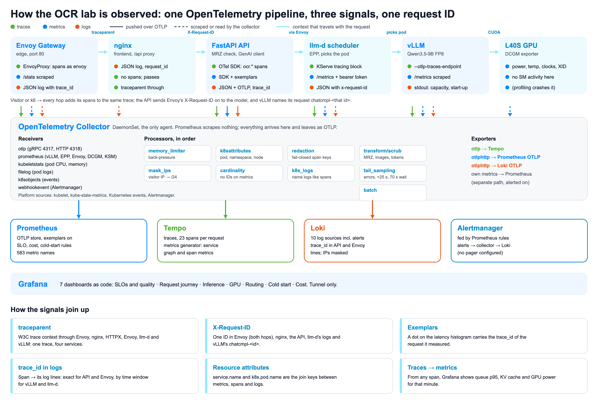
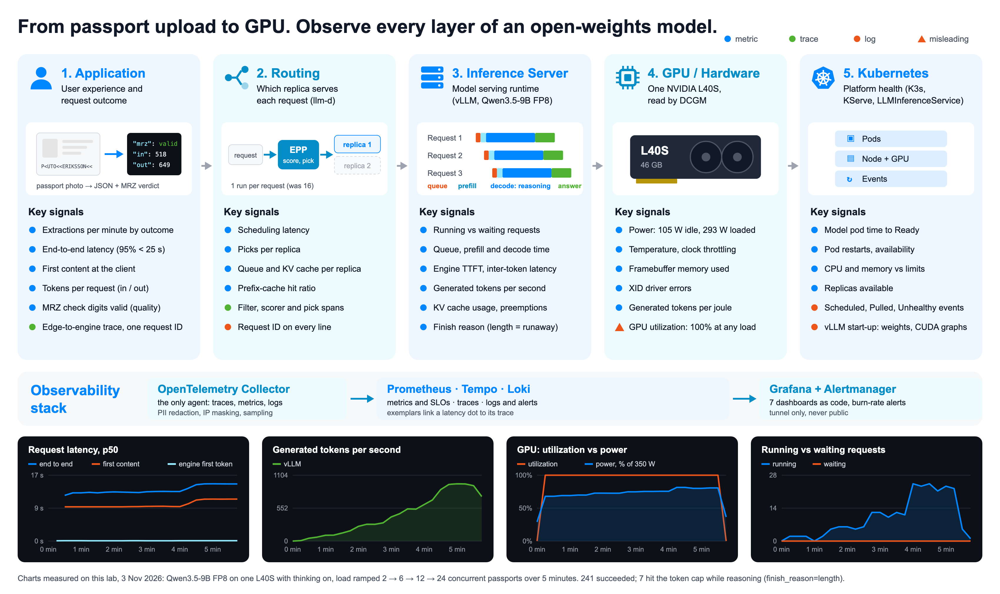

# OCR Lab: instrumenting an open-weights model end to end

A passport-extraction app built on an open-weights vision-language model, and the
observability that makes it explainable. Qwen3.5-9B (FP8, thinking on) is served by vLLM
through KServe's LLMInferenceService and the llm-d endpoint picker, behind Envoy Gateway,
with a FastAPI orchestrator and a static upload page in front. Every hop, from the edge proxy
to the GPU, reports through one OpenTelemetry Collector.

This branch (`instrumentation`) is the version behind the talk *Observing open weights*. It
contains no provider-specific infrastructure: bring any machine with one 24 GB+ NVIDIA GPU, or
none at all (a mock model runs the whole stack on a laptop).



## The story: one GPU node, measured

The lab ran on a **single preemptible cloud VM with one NVIDIA L40S (48 GB)**,
16 vCPU and 64 GB RAM, running single-node **K3s**. The model weights lived on a separate
persistent disk so a stopped or rebuilt VM didn't download them again. Admin access (SSH, the
Kubernetes API, Grafana) went only through a WireGuard tunnel. The upload page was the only thing
reachable from outside, and only ever received synthetic or specimen passports. The VM cost about
$0.87 per hour while running and was stopped between sessions.

On one node you can't blame the network or a noisy neighbour, so every surprise had to be
explained by the telemetry. The telemetry turned up a routing bug, a misleading GPU metric and a
quality/latency trade that latency alone hides. It also found its own silent failures.

What it found (all numbers measured on the GPU, never on the mock):

- **One request is mostly silence.** A 12.7 s extraction is 89% decode, and with thinking on the
  client sees nothing for about 10 s while the model reasons (476 of 651 output tokens).
- **GPU utilization doesn't measure load.** DCGM's `GPU_UTIL` read about 100% with one request in
  flight and with 24. Meanwhile throughput rose 52 → 961 tokens/s (18.6×), p50 latency rose only
  27% (12.7 → 16.2 s), and cost per 1,000 extractions fell from $3.22 to $0.18. Tokens/s, waiting
  requests, KV cache and power draw show the actual load.
  ([visual](talk/visuals/16-one-vs-many-requests.png))
- **Quality is a signal, not a feeling.** The MRZ check digits on a passport (ICAO 9303) give a
  label-free correctness check in production. In 40 passports at 8 concurrent, thinking on was
  2.7× slower (p50 14.1 vs 5.2 s) but made no wrong fields. Thinking off made 2 wrong fields but
  answered every passport, while thinking on left 3 unanswered.
  ([visual](talk/visuals/17-thinking-on-vs-off.png))
- **The trace found a real bug.** Each request ran the llm-d scheduler 16 times (168 spans per
  trace). Envoy Gateway added one endpoint-picker filter per path match of KServe's default route,
  which has 16 matches. A one-rule route fixed it: 23 spans, one scheduler run. Both traces are in
  [`talk/visuals/source/data`](talk/visuals/source/data).
- **Telemetry fails silently, and always toward "looks healthy".** The first 502 left
  availability at 100%. One idle `NaN` blanked a 28-day SLO. Alertmanager rejected a new config and
  kept the old one. A PII rule deleted `service.name`. A cold-start rule read 6,181 s instead of
  411 s. The GPU exporter sampled every 30 s by default. Each one is fixed in this branch, and the
  checks that catch them are listed in [`talk/LAB-GUIDE.md`](talk/LAB-GUIDE.md).

## Instrumentation strategy

### 1. OTLP is the spine; the collector is the only agent

Every signal reaches storage as OTLP through one OpenTelemetry Collector (a DaemonSet).
Prometheus scrapes nothing; it receives OTLP on its native endpoint, which keeps exemplars. Loki
and Tempo receive OTLP too. That one choice puts privacy, cardinality, sampling and correlation in
a single place, and keeps the backends replaceable.

| Layer | Source | How it becomes OTLP | What you get |
|---|---|---|---|
| Edge | Envoy Gateway | `EnvoyProxy` resource: OTLP/gRPC spans as service `envoy`, JSON access log with `%TRACE_ID%` | the first span of every trace, status codes, upstream timing |
| Web | nginx | no OTel; passes `traceparent` and `X-Request-ID` through, timed JSON logs | request ID in the front-door log |
| Application | FastAPI API | OTel SDK pushes traces, metrics with exemplars, and logs over OTLP/HTTP | outcome counters, end-to-end latency, MRZ validity, GenAI client spans |
| Routing | llm-d endpoint picker | KServe's `tracing` block pushes spans; Prometheus metrics scraped by the collector | which replica was picked and why, scheduler attempts |
| Inference | vLLM | `--otlp-traces-endpoint` pushes `llm_request` spans; `/metrics` scraped | queue, prefill, decode and TTFT per request; running/waiting requests, KV cache, tokens/s |
| GPU | DCGM exporter | scraped every 5 s (the exporter itself is set to 5 s; its default is 30 s) | utilization, power, memory, clocks, temperature |
| Kubernetes | kubelet, kube-state-metrics, API server | `kubeletstats`, `prometheus`, `k8sobjects` receivers | pod CPU/memory, readiness, events, cold start |
| Logs | every pod | `filelog` receiver, with `trace_id` lifted into structured metadata | one log stream per service, linked to traces |
| Alerts | Alertmanager | webhook → `webhookevent` receiver → OTLP logs | alerts stored and searchable next to the logs they explain |



### 2. Correlation: every hop carries the same identity

- **W3C trace context.** Envoy, nginx (pass-through), the API's HTTPX client, Envoy again, the
  scheduler and vLLM all honour `traceparent`, so a single trace runs
  Envoy → API → llm-d → vLLM.
- **One request ID end to end.** nginx keeps a client's `X-Request-ID` or makes one. The API sends
  it to the model, and an Envoy `ClientTrafficPolicy` (`PreserveOrGenerate`) stops the inner hop
  from replacing it. vLLM names the request `chatcmpl-<id>`, so the same ID appears in every log
  line and in the engine's own request name.
- **Resource attributes are the join keys.** `service.name`, `k8s.pod.name` and
  `k8s.namespace.name` are set the same way on metrics, spans and logs. Engine and scheduler logs
  are renamed to `vllm` and `inference-scheduler` to match their spans; when they didn't match,
  trace → logs found nothing.
- **Exemplars and Grafana links.** Latency histograms carry trace IDs. Grafana's Tempo data source
  links spans to their logs (`tracesToLogsV2`) and to metrics. vLLM's logs have no trace ID, so the
  link falls back to the engine and scheduler streams for the same time.
- **GenAI semantic conventions** (`gen_ai.usage.input_tokens`, `gen_ai.client.operation.duration`,
  `gen_ai.response.finish_reasons`), so the dashboards read any GenAI app the same way.

### 3. One policy for every signal, enforced in the collector

Processors, in order: `memory_limiter` → `k8sattributes` → `redaction` → `transform/scrub` →
`transform/mask_ips` → `transform/cardinality` → tail sampling → `batch`.

- **Privacy, fail closed.** Span attributes are allow-listed; anything else is dropped. Values that
  look like MRZ lines, base64 images or bearer tokens are scrubbed. Visitor IPs are cut to their
  /24 network. No image, prompt, reasoning text or extracted field leaves the app, and
  [`tools/pii-probe`](tools/pii-probe) sends deliberately leaky telemetry to prove it.
- **Cardinality budget.** Per-request attributes (URLs, client addresses, request and response IDs) are dropped from metrics before they reach Prometheus; IDs belong on spans and exemplars.
- **Tail sampling sized for LLM requests.** The collector waits 70 s before deciding on a trace
  (requests run up to ~30 s). It keeps every error and every trace slower than 25 s, plus a probabilistic baseline (100% in the lab, so every exemplar resolves; lower it with `TRACE_SAMPLE_PERCENT`).
- **The pipeline watches itself.** The collector's own metrics leave on a separate path and are
  alerted on (`TelemetryExportFailing`, `TelemetryRefusedByCollector`).

### 4. SLOs, cost and quality as code

SLOs (availability, latency ≤ 25 s, MRZ validity ≥ 75%) are written in
[`observability/slo/slos.yaml`](observability/slo/slos.yaml) and generated into recording rules and
dashboards. Cost per request comes from the GPU-hour price in
[`charts/observability/values.yaml`](charts/observability/values.yaml) (`pricing.gpuHourlyUsd`;
set it to what you pay) divided by measured throughput. Retention is 30 days for traces, metrics
and logs, so a whole test campaign can be compared after the fact.

The details for each piece (pipeline config, PII rules, cardinality, SLO maths, cold start) are in
[`observability/README.md`](observability/README.md).

## Run it on your own infrastructure

### No GPU: everything on a laptop

The same KServe, llm-d, Gateway API and observability stack on a kind cluster.
`apps/mock-llm` stands in for vLLM (two replicas) behind the real llm-d endpoint picker, so
routing, dashboards, SLOs and the PII rules can be rehearsed. Mock latencies are illustrative;
don't quote them.

```bash
python tools/passport-gen/generate.py --count 300 --out loadtest/data/passports
./scripts/lab-up.sh                       # kind + KServe/llm-d + observability + apps
kubectl -n envoy-gateway-system port-forward svc/<envoy service printed by the script> 8080:80
k6 run -e BASE_URL=http://localhost:8080/api -e SCENARIO=users loadtest/k6/ocr-users.js
```

No Kubernetes at all: `docker compose -f observability/local/compose.yaml up` runs the app, the
mock and the telemetry stack (no gateway or endpoint picker).

### One GPU node

Any Ubuntu 22.04/24.04 machine with one NVIDIA GPU of 24 GB or more and driver ≥ 580 (vLLM v0.31
is built for CUDA 13.0): a cloud VM from any provider, or a workstation. You need SSH as a sudoer.

```bash
VM_IP=<your-vm-ip> SSH_USER=<ssh-user> \
API_IMAGE=ghcr.io/<you>/ocr-lab/api:0.2.0 \
FRONTEND_IMAGE=ghcr.io/<you>/ocr-lab/frontend:0.2.0 \
./scripts/provision.sh
```

`provision.sh` bootstraps K3s (Traefik off) and nvidia-container-toolkit over SSH, copies the
kubeconfig back to `~/.kube/ocr-lab.config`, and runs `scripts/lab-up.sh PROFILE=gpu`: NVIDIA
device plugin, KServe v0.21 with llm-d and Envoy Gateway, the observability stack, Qwen3.5-9B, the
API and the frontend. It is safe to re-run; `SKIP_BOOTSTRAP` / `SKIP_DEPS` skip completed steps.
Allow 7–11 minutes for the first model start (weights download, then compilation).

Then:

```bash
export KUBECONFIG=~/.kube/ocr-lab.config
kubectl -n monitoring port-forward svc/kps-grafana 3000:80    # Grafana on localhost:3000
curl -F file=@passport.png http://<vm-ip>/api/extract          # or open http://<vm-ip>/
```

What we'd recommend from running it:

- **Keep admin off the internet.** Expose only port 80 (or better, 443 with a login) and reach
  SSH, the Kubernetes API and Grafana through a VPN or SSH tunnel. Change Grafana's default
  password in `observability/values/kube-prometheus-stack.yaml` before you install.
- **Put the weights on their own disk** mounted at `/var/lib/ocr-lab-models`
  (`charts/model-llmd` `weights.hostPath`). The model is 14 GB, and a rebuilt VM then starts
  without downloading it.
- **Preemptible or spot GPUs are fine for a lab.** Expect to delete a few dead model pods after a
  restart.
- **Set your GPU price** in `charts/observability/values.yaml` so the cost panels are yours.
- **Profiling fields may not work on cloud GPUs.** On the lab's VM any `DCGM_FI_PROF_*` field
  crashed the exporter, so [`counters.csv`](charts/observability/files/dcgm/counters.csv) leaves
  them out; try them on your hardware.

Load tests and the talk's measurement scripts are in [`loadtest/`](loadtest/README.md) and
[`talk/visuals/source`](talk/visuals/source). Point the scripts at your app with `OCR_LAB_URL`.
[`talk/LAB-GUIDE.md`](talk/LAB-GUIDE.md) has the queries and commands to verify each layer.

## Repo layout

```
apps/
  api/            FastAPI orchestrator (MRZ validation, OpenTelemetry SDK)
  frontend/       Static upload page + nginx config (request ID, trace context pass-through)
  mock-llm/       Fake vLLM for running everything without a GPU
  vllm-otel/      vLLM v0.11 + OpenTelemetry packages (legacy path only; v0.31 ships them)
charts/
  model-llmd/     KServe LLMInferenceService: Qwen3.5 on vLLM, or the mock (mode=mock)
  model/          Legacy: KServe v0.14 InferenceService + ServingRuntime (Qwen3-VL, vLLM v0.11)
  mock-model/     apps/mock-llm Deployment + Service
  api/            FastAPI Deployment + Service
  frontend/       nginx Deployment + Service + Ingress (or HTTPRoute)
  observability/  Collector pipeline, Envoy telemetry, scrape targets, SLO/cost rules, dashboards
observability/    Stack install (Prometheus, Grafana, Tempo, Loki, Collector, DCGM),
                  local docker-compose stack, SLOs and dashboards as code
loadtest/         k6 (many users, scored against ground truth) + GuideLLM (engine)
tools/
  passport-gen/   Synthetic passports with ground truth
  pii-probe/      Sends leaky telemetry to prove the collector's PII policy
scripts/
  provision.sh           GPU machine end to end: bootstrap → lab-up.sh PROFILE=gpu
  bootstrap.sh           Runs on the machine: K3s (no Traefik) + nvidia-container-toolkit
  lab-up.sh              Whole lab on Kubernetes: PROFILE=local (kind, mock) or gpu
  install-llmisvc.sh     KServe v0.21 + LLMInferenceService + llm-d + Envoy Gateway
  install-cluster-deps.sh  NVIDIA device plugin (+ legacy cert-manager · KServe v0.14)
talk/             Slides, the lab guide, and the talk visuals with the data and scripts behind them
tests/            API tests; fixture passports are gitignored
```

## Versions

| Piece | Version | Why |
|---|---|---|
| Qwen3.5-9B FP8 (`RedHatAI/Qwen3.5-9B-FP8-dynamic`) | — | vision built in; 14 GB leaves KV-cache room on a 24 GB GPU; thinking on for accuracy |
| vLLM | 0.31.0 | the release llm-d ships; includes the OpenTelemetry packages |
| KServe | 0.21.0 | LLMInferenceService with the llm-d endpoint picker, InferencePool, Gateway API |
| llm-d endpoint picker | 0.10.0 | |
| Envoy Gateway / Envoy | 1.8.1 / 1.38.1 | |
| K3s | 1.36 | single binary for a single node; Traefik off so Envoy Gateway owns 80/443 |
| OTel Collector | 0.162.0 | |
| Prometheus / Loki / Tempo | 3.15 / 3.6 / 3.1 | all receive OTLP natively |
| DCGM exporter | 4.8.4 | |

The original setup (vLLM v0.11, KServe v0.14 RawDeployment, Qwen3-VL-4B) stays in
`charts/model` as the talk's "before".

## Security notes

- No secrets in this repo. Infrastructure code you add should write keys to a gitignored
  `.secrets/` directory.
- Use only synthetic or specimen passports. The fixtures are gitignored, and
  `tools/passport-gen` makes synthetic ones with ground truth.
- The API never logs image bytes, and the collector drops anything that looks like a passport
  field.
- The upload page has no HTTPS, login or rate limit. Don't expose it beyond a lab.
